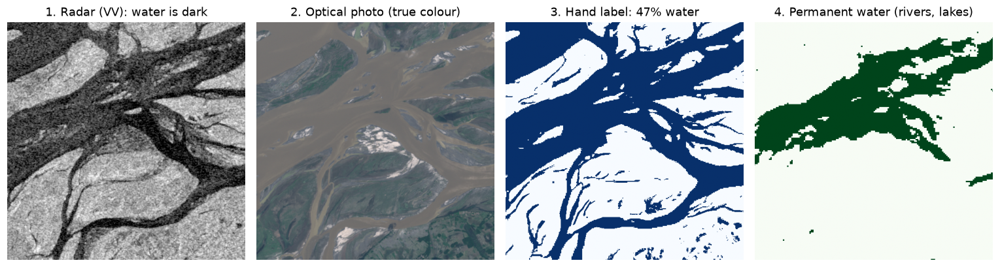
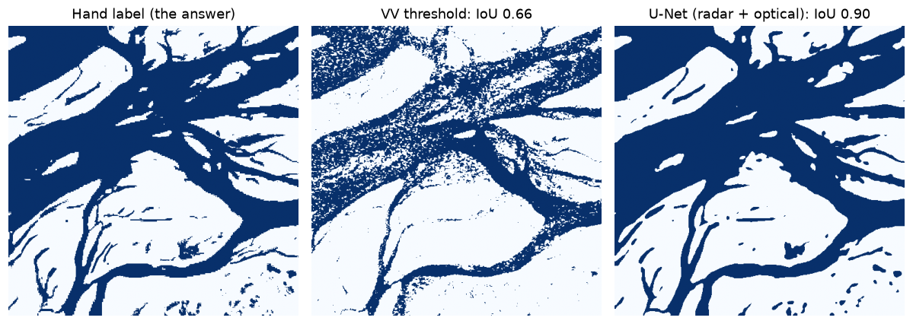

## The question in one paragraph

When a big flood hits, rescue teams and aid agencies need a map of where the water is, fast. Satellites can
provide that map, but the storm clouds that bring the rain also hide the ground from ordinary cameras in
space. A special kind of satellite, a **radar** satellite, can see through cloud. This project takes five
different ways of turning radar pictures into "water / not water" maps, from a one-line rule to an
advanced image-reading **model** (a computer program that has learned a pattern from examples). It then
asks a practical question: if a method learned from ten past floods, how well does it work on an
eleventh flood it has never seen? That matters because the next real flood is always a new one.

## Why it matters

Think of a doctor who trained only in one hospital. They may be excellent there, but the real test is how
they cope in a different hospital, with different patients and equipment. Flood-mapping methods face the
same problem. Every flood is different: the landscape, the season, how deep the water is, how windy it is.
A method that looks brilliant when tested on floods it already "knows" can disappoint on a new one.

People who would care include emergency responders deciding where to send boats, insurers estimating
damage, and the researchers and agencies who build flood-mapping tools. For all of them, the honest
answer to "how good is this map on a brand-new flood?" is more useful than a flattering score on
familiar ground.

## The data, explained

**Where it comes from.** The project uses a public research collection called **Sen1Floods11**, published
by Bonafilia and colleagues in 2020. It is freely downloadable, and no account is needed. It contains
pictures from two European Space Agency satellites:

- **Sentinel-1**, a radar satellite. It sends out its own microwave signal and listens for the echo, so it
  works day or night and through cloud. Calm water acts like a mirror and bounces the signal away from
  the satellite, so water looks **dark** in a radar picture. Rough land scatters some signal back and looks
  brighter. The radar records two slightly different versions of the echo, called **VV** and **VH**
  (two "polarisations", a bit like two different filters on a camera).
- **Sentinel-2**, an ordinary "optical" satellite that photographs the ground in visible and infrared
  light, much as a camera would. It sees colours clearly, but not through cloud, and flood pictures are
  often partly cloudy.

**What one record is.** The basic unit is a **chip**: a square picture about 5 km by 5 km, made of
512 by 512 tiny squares called **pixels**, each about 10 m across (roughly the size of a small house). For
each chip there are five layers stacked on top of each other:

1. the radar picture (VV and VH);
2. the optical picture from around the same dates;
3. a **hand label**: a person has marked every pixel as water, not water, or "can't tell";
4. a **permanent-water map** from an existing global survey of rivers and lakes, which lets the project tell
   normal water (rivers, lakes) apart from new floodwater;
5. a water map made by the dataset's own authors using a standard automatic method (one of the five methods
   compared here).

**How much there is.** There are **446 hand-labelled chips** from **11 floods on six continents**: Bolivia
(15 chips), Ghana (53), India (68), the Mekong region (30), Nigeria (18), Pakistan (28), Paraguay (67),
Somalia (26), Spain (30), Sri Lanka (42) and the USA (69). The full download is about 2 GB.

**Quirks worth knowing.**

- Water is rare. Only about **1 in 10** labelled pixels in the training chips (9.5%) is water, so a lazy
  method that says "no water anywhere" would look right most of the time while being useless.
- How much water a flood has varies widely: about 5% of labelled pixels in the USA chips, but about 24% in
  the Nigeria and Mekong chips.
- Some pixels have no radar reading or no label. They are left out of every score.

**What one chip looks like.** Here are four of the layers for one real chip from the India flood
(chip India_900498), a wide, braided river in flood:

Compare pictures 3 and 4: the green area is where the river normally runs; everything else that is blue
in picture 3 is new floodwater. Almost half of this chip (47%) is water. On this chip, water's median
radar brightness is about −18.4 dB and dry land's about −8.7 dB, a big gap, so it is one of the easier
chips.

**What a few pixels look like.** Each chip is really a grid of numbers. Here are six real pixels from the
same chip. VV and VH are the two radar brightnesses in dB (more negative means darker). The water index
comes from the optical photo; above 0 usually means water. The last two columns show what two of the
methods said about each pixel, when tested as a "new flood" (trained only on the other ten floods).

| Pixel (row, column) | VV (dB) | VH (dB) | Water index | Hand label | Permanent water? | VV threshold says | Radar + optical U-Net says |
|---|---:|---:|---:|---|---|---|---|
| (177, 87) | −22.3 | −25.0 | 0.18 | water | yes | water | water |
| (263, 395) | −15.5 | −35.4 | 0.22 | water | no | **dry (wrong)** | water |
| (356, 419) | −17.0 | −37.1 | 0.15 | water | no | water | water |
| (104, 328) | −13.2 | −23.7 | 0.13 | dry | no | dry | **water (wrong)** |
| (19, 16) | −5.4 | −15.1 | −0.37 | dry | no | dry | dry |
| (455, 232) | −7.9 | −19.0 | −0.06 | dry | no | dry | dry |

The second row shows why a single cut-off struggles. That pixel is real floodwater, but at −15.5 dB it is
not quite dark enough for the cut-off learned from the other floods (−16.75 dB), so the simple rule calls
it dry. Its very dark VH value and positive water index give it away to the model that sees everything.
No method is perfect, though: in the fourth row the best model raises a false alarm on dry land.

## The journey, step by step

### Step 1: Getting and preparing the data

A download script fetches the whole dataset from its public online storage. The app can also fetch single
chips on demand, so a visitor never has to download everything. One shared piece of code then turns each
chip into a consistent input. Very extreme radar values are capped, the radar values are put on a common
scale (using averages measured once from the training chips), and a third radar layer is added: the
difference between VH and VV. For the method that also uses the optical picture, six optical colour
bands are added, plus a standard "water index" that highlights water. Because training, testing and the
app all use this same code, the data cannot be prepared in slightly different ways in different places.

### Step 2: Five methods, from simplest to most advanced

1. **VV threshold.** The simplest possible rule: "any pixel darker than a certain radar value is water."
   The cut-off value is chosen as the one that worked best on the training chips. On the official training
   chips it came out at −16.75 **dB**, the unit radar brightness is measured in (more negative means
   darker).
2. **Authors' Otsu.** Also a darkness cut-off, but a new one is picked for every scene by a standard
   automatic technique (Otsu's method) that looks for the natural split between dark and bright pixels.
   It needs no training. The project uses the maps the dataset's authors published, as they are.
3. **LightGBM (radar + texture).** A **machine-learning** model (a program that learns rules from labelled
   examples instead of being told them). It looks at one pixel at a time, together with simple facts about
   its neighbourhood: how bright and how "speckled" (uneven) the surrounding area is, at two sizes (about
   50 m and 150 m across). Radar pictures are grainy, so a single pixel can be dark or bright by chance;
   the average brightness of the area around it is a much steadier clue, and it turns out to be the one
   the model leans on most. Technically it is a "gradient-boosted
   trees" model: many small yes/no decision rules added together.
4. **U-Net (radar).** A **neural network** designed for pictures. Instead of looking at one pixel, it
   looks at whole areas and can pick up shapes such as shorelines, field patterns and river bends. It
   sees only the radar layers.
5. **U-Net (radar + optical).** The same kind of network, given the optical colour bands and water index
   as well as the radar.

### Step 3: Teaching the learning methods

The three learning methods (LightGBM and both U-Nets) learn from **training data**: chips where the right
answer (the hand label) is known. The LightGBM model learns from a random sample of up to 20,000 pixels
per chip, so that no single big, easy chip dominates. The U-Nets are shown small random squares cut from
the chips, turned and flipped at random so they learn that water looks like water whichever way up the
picture is. They are scored on separate checking chips after each round of practice (an **epoch**), and
the round that scored best is kept. Because water is rare, the U-Net's learning goal includes a part
that rewards getting the water itself right, not just the easy dry land.

### Step 4: First test, the official benchmark ("familiar floods")

The dataset comes with its own standard split, the **official benchmark**: 252 chips for training, 89 for
checking settings (**validation**), and 90 for the final **test**. All three groups are drawn from the
same 10 floods. A separate set of 15 Bolivia chips is kept out entirely. So the test chips come from
floods the models have already seen other parts of. This is the fair comparison most research uses, but
it is the "home hospital" test.

### Step 5: The main test, leave one flood out ("new floods")

This is the heart of the project. For each of the 11 floods in turn, every learning method is trained
from scratch on the other 10 floods and then scored on the one left out. This is called
**leave-one-event-out** testing. For the U-Nets, the "best round" is chosen using a tenth of the
*training* chips, so the left-out flood is never peeked at. This means 11 separate rounds of training
for each method, including 22 separate U-Net trainings. Every method's map of every chip, made this way,
is saved so it can be examined later and shown in the app.

The project also records, for each flood, its **oracle threshold**: the darkness cut-off that would have
been best for that flood if you already knew the answers. Comparing it with the cut-off learned from the
other 10 floods shows how much the "right" rule moves between floods.

### Step 6: How the maps are scored

The main score is **IoU** (intersection over union). Picture two overlapping shapes: the water the method
marked, and the water that is really there. IoU is the overlap divided by the total area covered by
either shape. A perfect map scores 1; a map with no overlap scores 0. It punishes both missed water and
false alarms, and it ignores the huge area of easy dry land, which makes it a tough, honest score. Two
supporting scores are also used: **recall** (of all the real water, what share did the method find?) and
**precision** (of everything the method called water, what share really was water?).

Here is what that looks like on the India chip from earlier, with both methods tested as a "new flood":

The VV threshold gets the main channels but turns the speckled river into scattered dots and misses
patches of floodwater, so it scores IoU 0.66. The radar + optical U-Net draws clean shapes close to the
hand label and scores 0.90.

### Step 7: Digging into why

Two extra analyses explain the results:

- **How visible is water to radar in each flood?** For each flood, the project measures how much darker
  water is than land, and how well radar darkness alone can sort water from land. That second measure is
  called **AUC**: 1.0 means a single cut-off would separate them perfectly, 0.5 means it is no better than
  a coin toss.
- **Where is water missed?** Using the saved left-out maps, the project checks how much permanent water
  (rivers, lakes) versus new floodwater each method found, and how results change with the amount of
  plant cover. Plant cover is measured with a standard "greenness" index from the optical pictures
  (**NDVI**), using only pixels not covered by cloud.

### Step 8: Checking the work

A set of automated checks (21 tests, run on small made-up data so no download is needed) confirms that the
building blocks behave as intended: for example, that the scoring ignores "can't tell" pixels, that a
perfect map scores 1, that missing radar values are handled safely, and that the picture-reading network
produces a map of the right size for any input. A further check confirms that the bundled results cover
all 11 floods and all 446 chips and that the app starts up. These checks run automatically whenever the
code changes.

## What we found

**1. On familiar floods, more advanced methods are clearly better.** On the official test chips, the
IoU scores rise step by step: VV threshold 0.46, authors' Otsu 0.55, LightGBM 0.64, U-Net (radar) 0.67, and
U-Net (radar + optical) 0.83. Adding the optical picture gives the biggest single jump. The best model
finds about 9 in 10 of the real water pixels (recall 0.89), and about 9 in 10 of the pixels it calls
water really are water (precision 0.92).

**2. On a new flood, every method gets worse.** Scored on floods they never saw, the pooled IoU scores
across all 11 floods are: VV threshold 0.43, authors' Otsu 0.50, LightGBM 0.57, U-Net (radar) 0.59, and
U-Net (radar + optical) 0.78. The drops from familiar to new floods range from 0.03 (VV threshold) to
0.09 (U-Net radar).

**3. The radar + optical U-Net is the best method on every one of the 11 new floods.** It also loses
relatively little going from familiar to new floods (0.83 to 0.78).

**4. The "right" darkness cut-off moves a lot between floods, but a learned one hardly moves at all.**
Each flood's own best cut-off ranges from −18.25 dB (USA) to −12.50 dB (Sri Lanka), a spread of
5.8 dB. Yet the cut-off learned from the other ten floods always lands between −16.75 and −16.00 dB,
essentially one number. In Sri Lanka, where water looks unusually bright to radar, the fixed rule is badly
wrong: it scores IoU 0.16, while the per-scene Otsu method, which picks a fresh cut-off for each scene,
scores 0.65.

**5. For radar-only methods, the flood matters more than the method.** A radar-only method's score
changes by about 0.61 on average from its best flood to its worst. On the same flood, the different
radar-only methods differ by only about 0.19 on average. In everyday terms: knowing *which flood* you are
mapping tells you more about how good the map will be than knowing *which radar method* you used. Every
method's score goes up and down with how visible water is in that flood (correlations between 0.68 and
0.84, where 1 would be a perfect match).

**6. How visible water is to radar varies hugely between floods.** In Somalia, water is only about 2.6 dB
darker than land (AUC 0.70, not far above a coin toss). In the Mekong, it is about 12 dB darker (AUC 0.97,
nearly perfect). Somalia is also where the optical picture helps most: the best radar-only method scores
0.27 there, while radar + optical scores 0.70. The radar + optical U-Net's scores span only 0.32 across
floods (from 0.60 in Paraguay to 0.92 in the Mekong), against about 0.57 to 0.63 for each radar-only
method.

**7. Methods miss new floodwater, not rivers and lakes.** Every method finds between about 75% and 99% of
permanent water, but only between about 45% and 81% of new floodwater. The radar + optical U-Net finds 81%
of new floodwater; the radar-only U-Net finds 62%; the simple threshold 45%.

**8. Water among plants is close to invisible.** Looking at the best model on cloud-free pixels: where
there is little or no vegetation it finds about 91% of the water, but this falls to about 24% where plants
are sparse, about 5% where they are moderate, and about 1% where they are dense. A caution: labelled
water is rare among plants (about 2% or less of those pixels), so these figures rest on small amounts of
water.

**9. Even the official benchmark's held-out flood shows the surprise.** On the 15 Bolivia chips, which the
official split keeps out, the simple per-scene Otsu method (0.72) beats both LightGBM (0.40) and the
radar-only U-Net (0.60). Only the radar + optical U-Net does better (0.81).

## How to read the main charts

The project does not save its charts as separate image files; they are drawn live inside the technical
report and the app. Here is how to read the three most important ones when you open them.

**The per-flood colour grid** (app, "Transfer Across Floods" page; also a coloured table in the report).
Each column is a flood and each row is a method. Each square shows that method's IoU score on that flood
when the flood was left out of training, coloured from red (poor, near 0) through yellow to green (good,
near 1). The floods are ordered from hardest for radar on the left to easiest on the right. What to look
for: the colours change much more as you move *across* (from flood to flood) than *down* (from method to
method), except for the radar + optical row, which stays greener throughout.

**The moving-threshold chart** (app and report, "Why fixed rules break"). Each flood has a vertical line
with two markers. The dot is the darkness cut-off that would have been best for that flood; the cross is
the cut-off learned from the other ten floods. Higher on the chart means a brighter cut-off. What to look
for: the crosses sit in an almost flat row, while the dots jump up and down. The longer the grey line
between them, the more wrong a fixed rule is for that flood; Sri Lanka has the longest.

**The "flood matters more than the method" scatter plot** (app "Why Floods Differ" page and report).
Each dot is one method on one flood. Left to right shows how visible water is to radar in that flood
(the AUC score); bottom to top shows the method's score. What to look for: the dots rise from bottom-left
to top-right, so floods where water is easy to see give good scores for every method, and hard floods
drag every radar method down together.

## Try it yourself

The interactive app (online at <https://flood-radar-analytics.streamlit.app>) has four pages. It shows
results that were already computed, so it opens quickly.

- **Transfer Across Floods** (the front page). Shows each method's overall score on new floods as large
  numbers, the per-flood colour grid, and the moving-threshold chart, with a short explanation.
- **Why Floods Differ.** A table showing, for each flood, how much of it is water, how dark water and land
  are, and how well radar separates them. Then the scatter plot linking that to each method's score, with
  the correlation for each method. Then a table of how much permanent water and new floodwater each method
  found. A drop-down menu lets you pick any method and see how its results change with plant cover.
- **Official Benchmark.** The scores on the standard validation, test and Bolivia chips; precision and
  recall on the test chips; the learned cut-off value; and a line chart showing how the radar + optical
  U-Net's validation score improved over its rounds of training.
- **Chip Explorer.** Pick any flood and any of its chips. You see the radar picture (water is dark), the
  optical photo (often cloudy), and the hand label with its share of water. Below, you see each method's
  water map for that chip, made without ever seeing that flood, with its IoU score. This is the best way to
  see with your own eyes where each method succeeds or fails. The chip is downloaded from the public
  dataset when you open it.

For more depth:

- **Technical report:** `report/report.qmd` (rendered as `report/report.html` and `report/report.pdf`, and
  online at <https://nhamhung.github.io/flood-radar-analytics/>). It walks through data, methods, results
  and limitations with charts.
- **Notebooks:** two step-by-step guides for developers. `notebooks/01_flood_radar_analytics.ipynb`
  covers the data, scoring, the threshold, Otsu and LightGBM methods (trained live) and both tests;
  `notebooks/02_unet_walkthrough.ipynb` explains the U-Net and trains a small demo version.
- **Trained models:** the full runs' trained models are not included; the scripts `scripts/train.py` and
  `scripts/cross_event.py` recreate them.

## What this project can't tell you

- **Eleven floods is a small sample.** "How well does it work on a new flood?" is answered from only 11
  examples, and each flood's score rests on just 15 to 69 chips. Some floods contain little water.
- **The best model needs a clear-ish sky.** The radar + optical model was trained and tested on optical
  pictures that are sometimes partly cloudy, but how it behaves when cloud covers everything was not
  tested separately. In a real flood, there is often no cloud-free optical picture at all; then only the
  radar-only results apply, and they are much weaker.
- **Hand labels are not perfect.** People drawing water by hand can disagree, especially at shorelines and
  where water lies among plants.
- **Water among plants is barely detected**, and the figures on it rest on small amounts of water.
- **One way of processing radar.** All radar here was prepared the same way. Radar prepared by a
  different process can differ by several dB, which could quietly break these methods.
- **It is a comparison, not a live service.** The project measures how well methods transfer; it does not
  produce maps for floods happening today.

## Glossary

**AUC.** A score from 0.5 to 1 for how well a single measurement (here, radar darkness) can sort two groups
(water and land). 1 means perfectly; 0.5 means no better than a coin toss.

**Chip.** One square picture from the dataset, about 5 km by 5 km, made of 512 by 512 pixels.

**dB (decibel).** The unit for radar brightness. The values here are negative; more negative means darker.
A difference of a few dB is a big difference in brightness.

**Epoch.** One full round of practice, in which a learning model sees all its training examples once.

**Hand label.** The correct answer for each pixel (water or not water), drawn by a person.

**IoU (intersection over union).** The main score. The overlap between the predicted water and the real
water, divided by the area covered by either. 1 is perfect, 0 is no overlap.

**Leave-one-event-out.** A testing approach: train on all floods except one, test on that one, and repeat
for every flood. It shows how a method copes with a flood it has never seen.

**LightGBM.** A popular machine-learning tool that builds many small yes/no decision rules and adds them
together. Here it looks at one pixel and its neighbourhood at a time.

**Machine learning.** Getting a computer to learn rules from labelled examples instead of writing the rules
by hand.

**Model.** A program that has learned a pattern from examples and can apply it to new cases; here, to
decide which pixels are water.

**NDVI.** A standard "greenness" score calculated from optical pictures. Higher means more plant cover.

**Neural network.** A kind of model loosely inspired by the brain, made of many layers of simple
calculations. Good at finding patterns in pictures.

**Official benchmark / test / validation.** The dataset's standard split. Training chips are for
learning, validation chips for checking settings during learning, and test chips for the final score.

**Optical satellite (Sentinel-2).** A satellite that photographs the ground in visible and infrared
light. Clear picture, but blocked by cloud.

**Oracle threshold.** The darkness cut-off that would have been best for a flood if you already knew the
answers. Useful for comparison, impossible in real life.

**Otsu's method.** A standard technique that picks a darkness cut-off automatically for each picture by
finding the natural split between dark and bright pixels.

**Permanent water.** Rivers and lakes that are there in normal times, as opposed to new floodwater.

**Pixel.** One tiny square of a picture; here about 10 m by 10 m on the ground.

**Precision.** Of everything a method called water, the share that really was water. Low precision means
many false alarms.

**Radar (Sentinel-1).** A satellite that sends out its own microwave signal and measures the echo. Works
day and night and through cloud. Calm water looks dark.

**Recall.** Of all the real water, the share the method found. Low recall means much water was missed.

**Threshold.** A cut-off value: everything darker than it is called water.

**Training data.** The labelled examples a model learns from.

**U-Net.** A type of neural network designed to label every pixel of a picture, using the surrounding
area (shapes, edges, texture) rather than one pixel alone.

**VV and VH.** Two versions of the radar echo, sent and received with the signal oriented in slightly
different ways. They react differently to water, plants and buildings.
